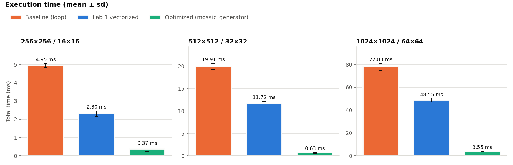
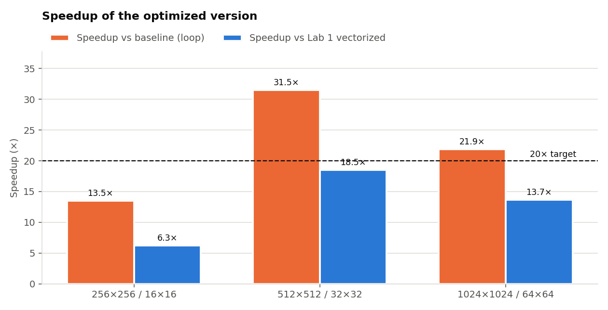

# Image Mosaic Generator

This app divides an image into a grid, matches every grid cell to the closest tile, and
rebuilds the image out of tiles. It is the Lab 1 mosaic generator, profiled, optimized
and refactored into a package in Lab 8. On a 512×512 image with a 32×32 grid, it is
**31.5× faster** than my Lab 1 baseline and makes the same mosaic.

**▶ Live demo:** <https://huggingface.co/spaces/sqz0914/image-mosaic-generator>

The Space sleeps when nobody uses it, so the first visit can take about half a minute.

## Contents

- [Installation](#installation)
- [Usage](#usage)
- [Project structure](#project-structure)
- [Performance](#performance)
- [Sample images](#sample-images)
- [Deployment](#deployment)

## Installation

You need **Python 3.12 or newer**, because `numpy==2.5.3` requires it.

```bash
cd mosaic-generator
python -m venv .venv

# Windows
.venv\Scripts\activate
# macOS / Linux
source .venv/bin/activate

pip install -r requirements.txt
```

`requirements.txt` pins every package version. It includes the web app, the notebook
(`matplotlib`, `pandas`, `line_profiler`, `ipykernel`) and the tests (`pytest`).

## Usage

### Web app

```bash
python app.py
```

Then open <http://127.0.0.1:7860>. The app has three tabs.

| Tab | What it does |
|---|---|
| **Mosaic** | Upload an image or pick an example, choose the settings, and press **Generate mosaic**. It shows the preprocessed image, the segmented grid and the mosaic, with the **processing time** of each step and the similarity scores (MSE and SSIM). |
| **Tile sets** | Preview any built-in tile set at any tile size. |
| **Performance** | The processing time at grid sizes 16, 32, 64 and 128, with the current image and settings. |

If an input cannot be used, for example a grid that is larger than the image, the app
shows a message that explains why.

### Python package

```python
from mosaic_generator import MosaicBuilder, TileManager

# Choose the tiles and the settings
tile_manager = TileManager("Halftone Dots", tile_px=16)
builder = MosaicBuilder(tile_manager, grid_size=(32, 32))

# Make a mosaic (from a NumPy array, a PIL image or a file path)
mosaic = builder.create_mosaic("assets/vibrant-sunflower-bloom-stockcake-512x512.jpg")
similarity = builder.compute_similarity("assets/vibrant-sunflower-bloom-stockcake-512x512.jpg", mosaic)
print(similarity)        # Scores(mse=..., ssim=...)

# Or get everything at once, including the processing time of each step
result = builder.build("assets/vibrant-sunflower-bloom-stockcake-512x512.jpg")
print(result.elapsed_ms, result.stages_ms)
```

The main settings of `MosaicBuilder` are listed below. All defaults are in
`mosaic_generator/config.py`.

| Setting | Default | Meaning |
|---|---|---|
| `grid_size` | 48 | Number of cells across the image (or a `(rows, cols)` pair) |
| `color_mode` | `"Modulate"` | `"Tile only"`, `"Blend"` or `"Modulate"` |
| `strength` | 0.85 | How strongly each cell's color tints its tile, 0 to 1 |
| `match_space` | `"RGB"` | Color space for matching, `"RGB"` or `"CIE-Lab"` |
| `detail_weight` | 0.0 | Weight of texture matching, 0 to 1 |
| `quantize_k` | 0 | Reduce the cell colors to k colors first (0 = off) |
| `long_edge` | 768 | Working resolution: the longest side after resizing, in pixels |

**Tiles.** There are four built-in tile sets, which are drawn by code: ASCII Art,
Halftone Dots, Geometric Blocks and LEGO Studs. You can also use your own tiles from a
folder of images:

```python
tile_manager = TileManager(tile_directory="my_tiles/", tile_px=16)
```

Every readable image in the folder becomes one tile, cropped to a square. Files that
cannot be read are skipped with a warning. A missing folder, or a folder with fewer than
two readable images, gives a clear error.

### Tests

```bash
python -m pytest
```

The tests check every module, the error messages, and that the mosaic is the same as the
Lab 1 baseline. Another test checks that every function has a docstring with its
parameters and return value.

### Profiling notebook

```bash
jupyter notebook profiling_analysis.ipynb
```

Choose the kernel of your virtual environment. The notebook profiles the Lab 1 baseline
(Part 1) and compares it with the optimized version (Part 2). It saves its charts and
timing tables in `results/`.

## Project structure

```
mosaic-generator/
├── mosaic_generator/           # the package
│   ├── __init__.py             # exports MosaicBuilder, TileManager
│   ├── image_processor.py      # image loading, resizing, grid division, cell colors
│   ├── tile_manager.py         # TileManager: built-in or folder tiles, caching, features
│   ├── mosaic_builder.py       # MosaicBuilder: tile matching and mosaic reconstruction
│   ├── metrics.py              # similarity metrics (MSE, SSIM)
│   ├── config.py               # configuration constants
│   └── utils.py                # input validation, timing and memory helpers
├── baseline/                   # Lab 1 code, unchanged, used only by the notebook
├── app.py                      # Gradio web app
├── profiling_analysis.ipynb    # Lab 8 Parts 1 and 2: profiling and optimization
├── tests/test_mosaic.py        # unit tests
├── assets/                     # sample test images
├── results/                    # charts and tables saved by the notebook
├── requirements.txt
└── pytest.ini
```

`baseline/` is my Lab 1 code. The notebook needs it to time and profile the baseline.
The app and the package do not use it.

## Performance

I measured the full mosaic generation on the three required configurations. The
baseline is my Lab 1 loop version (`baseline/core.py`, `build_mosaic_loop`), because my
Lab 1 code was already vectorized. All times are the mean of 5 runs (50 for the optimized
version). The full analysis is in `profiling_analysis.ipynb`.

| Configuration | Baseline loop | Lab 1 vectorized | Optimized | Speedup vs baseline | Speedup vs Lab 1 vectorized |
|---|---:|---:|---:|---:|---:|
| 256×256 / 16×16 | 4.95 ms | 2.30 ms | 0.37 ms | 13.5× | 6.3× |
| **512×512 / 32×32** | **19.91 ms** | **11.72 ms** | **0.63 ms** | **31.5×** | **18.5×** |
| 1024×1024 / 64×64 | 77.80 ms | 48.55 ms | 3.55 ms | 21.9× | 13.7× |




### What I optimized

The profilers showed that almost all of the baseline's time was spent in four parts of
its Python loops. Each optimization below fixes one of them, or a slow part that I found
after the first fixes.

| # | Optimization | Problem it fixes |
|---|---|---|
| 1 | Compute all cell colors at once with `cv2.reduce` | `mean` was called once per cell (24%) |
| 2 | Match all cells to all tiles at once with broadcasting and `argmin` | The inner loop over the tiles (31%) |
| 3 | Cache the tile features, computed once per tile set | `tile @ LUMA` was computed for every cell (16%) |
| 4 | Build the whole mosaic with one `np.take` | Each tile was clipped and pasted one by one (16%) |
| 5 | Add each cell's color with OpenCV (`cv2.resize`, `cv2.add`, `cv2.subtract`) | NumPy broadcasting was slow here |
| 6 | Keep the full-size image in uint8 instead of float32 | Full-size float32 passes moved 4 times more memory |
| 7 | Reuse work buffers between calls | Writing into new memory is slow |

### Correctness

The optimized version picks **the same tile in 100% of the cells** in all three
configurations. Because of optimization 6 (rounding to uint8), some pixel values differ
from the baseline by 1 level out of 255, never more. The MSE between the two mosaics is
only about 0.25 to 0.27, and the two mosaics look the same.

## Sample images

The three test images used in the notebook are in `assets/`:

| File | Size |
|---|---|
| `vibrant-sunflower-bloom-stockcake-256x256.jpg` | 256×256 |
| `vibrant-sunflower-bloom-stockcake-512x512.jpg` | 512×512 |
| `sunflower-1024x1024.jpg` | 1024×1024 |

The web app does not need these files. Its example images (astronaut, coffee and cat)
come with scikit-image.

## Deployment

The app runs on Hugging Face Spaces (CPU basic). The YAML header at the top of this file
is the Space configuration, so this folder can be pushed to a Space as it is. Hugging
Face rejects binary files that are not stored with Xet/LFS, so leave `assets/*.jpg` and
`results/*.png` out of the Space, or track them with Git LFS.
